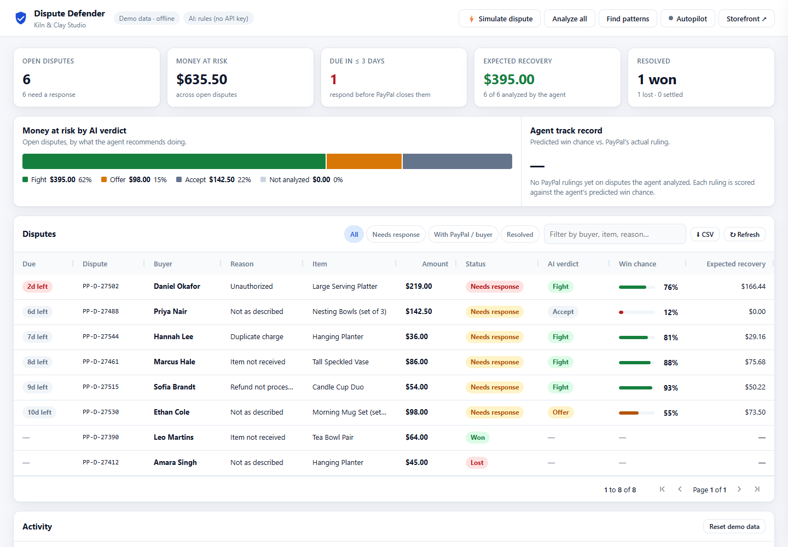
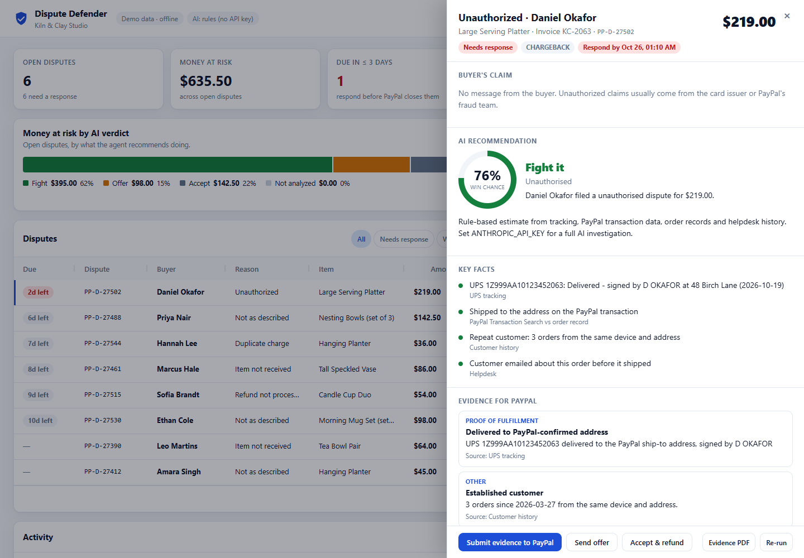
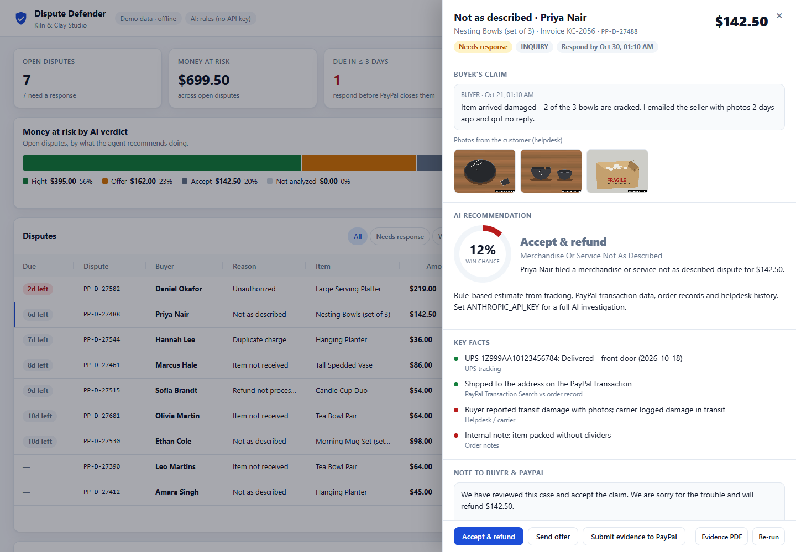
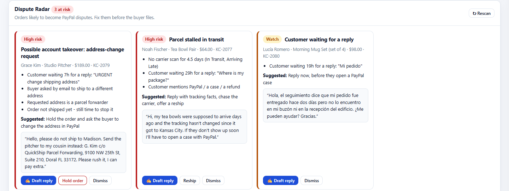
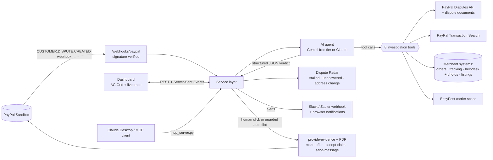

# Dispute Defender

**An AI agent that heads off PayPal disputes before they're filed, and investigates the ones that are, telling small merchants with evidence whether to fight, settle or refund.**

Built for the *Build What's Next with PayPal and AI* hackathon. It uses the PayPal Disputes, Transaction Search, Orders and Webhooks APIs with an AI agent that runs on **Google Gemini's free tier** or on **Claude** (`claude-opus-5-5`), switched with one setting.



> Demo video: _add your YouTube link here_ · Live demo: _add your Render URL here_ (password for actions: _in the submission_)

<!-- After pushing to GitHub, replace OWNER/REPO to show the CI badge: -->
<!--  -->

> Hosted on Render's free plan: if the demo has been idle, the first page load can take about 50 seconds while the server wakes up. It's not broken, just asleep.

---

## The problem

Small online sellers lose disputes they could have won. When a PayPal dispute comes in, the seller has to:

1. understand which of about 10 dispute reasons it is and what PayPal needs to see,
2. dig through PayPal, the order system, the carrier site and old emails for proof,
3. write a persuasive, factual response before the deadline,
4. decide whether fighting is even worth it.

Most small sellers don't have time for this. They either give up or submit weak evidence. Paid chargeback services exist, but they're built for large merchants.

## What Dispute Defender does

| | |
|---|---|
| **Prevents disputes (Dispute Radar)** | Watches orders for early warning signs: a parcel stalled in transit, a customer waiting for a reply ("I'll open a PayPal case"), or an emailed request to ship somewhere else, often to a parcel forwarder (a classic account-takeover pattern). Claude drafts the reply in the customer's language. You send it, hold the order or reship with one click. |
| **Picks up every dispute** | A PayPal `CUSTOMER.DISPUTE.CREATED` webhook (signature-verified) triggers an investigation automatically. An optional Slack or Zapier webhook and browser notifications alert you to new disputes and deadlines under 48h. |
| **Works from PayPal alone** | No store integration? The agent rebuilds the order from PayPal: the capture (with its **Seller Protection** status), the checkout order (items, ship-to, payer), the tracking you added, and the payer's history from Transaction Search. Carrier scans come from **EasyPost** (optional, free test mode). |
| **Investigates like an analyst** | An AI agent (Gemini or Claude) uses 8 tools: the PayPal dispute, PayPal Transaction Search, the store's order database, carrier tracking, helpdesk history, customer history, the product listing and policies, and attached photos. You can watch each tool call live. |
| **Looks at the photos** | Not-as-described disputes are won or lost on photos. The agent opens the buyer's photos (helpdesk attachments, or documents on the PayPal dispute) with Claude's vision. It describes what they actually show, such as cracks consistent with impact or one mug darker than the rest, and doesn't take the buyer's word for it. |
| **Recommends honestly** | **FIGHT**, **OFFER** (for example a partial refund) or **ACCEPT**, with a win probability, the key facts (each tagged with its source and which side it supports), risks, missing evidence, and a process fix to prevent the next dispute. It tells you when you'd lose. |
| **Drafts the response** | It writes a factual statement to PayPal that cites dates and IDs, a friendly message to the buyer, PayPal `provide-evidence` items (tracking info, refund IDs) and a PDF evidence packet. |
| **Human in the loop** | One click to submit evidence, send an offer, accept the claim or message the buyer through PayPal. Every money-moving action asks for confirmation. |
| **Guarded autopilot** | Optional. Evidence is auto-submitted only when the agent recommends fighting **and** the win probability and amount are inside limits you set. Everything else waits for you. |
| **Ask the agent** | What-if chat inside each dispute: *"What if I offer $30 instead?"* The agent answers from the evidence and gives a revised win chance and action. |
| **Gets money back from the carrier** | When a damage or loss dispute is best accepted, the agent drafts the carrier claim (tracking, value, the damage scan, photos) so the loss lands on the carrier, not the shop. |
| **Speaks the buyer's language** | Buyer messages are translated on demand, and replies to buyers are drafted in their language. Statements to PayPal stay in English. |
| **Shows the payoff** | The "Impact so far" panel shows money recovered, money kept through offers, losing fights avoided, disputes headed off by Radar, and time saved. Time saved is an estimate, based on an adjustable assumption about how long a case takes by hand. |
| **Finds patterns** | A cross-dispute analysis surfaces root causes (packaging, listings, address changes) with concrete fixes. |
| **AG Grid triage board** | Disputes sorted by deadline, with custom cell renderers for deadlines, verdicts and win-chance bars, status filter chips, quick search, CSV export, remembered column layout and full keyboard navigation. A chart above it shows where the money at risk stands by verdict. |
| **Keeps score** | Each PayPal ruling is compared with the agent's predicted win chance: rulings called correctly, plus a Brier score. `scripts/eval_agent.py` runs the agent against 8 labelled scenarios. |
| **Works from other agents (MCP)** | `mcp_server.py` exposes Dispute Defender to Claude Desktop or any MCP client, so you can ask "what's due this week?" or "fight Daniel's chargeback" in conversation. Actions that move money are marked destructive, so the client asks you first. |







### The six sample disputes (offline demo & benchmark data)

*Note: These six pre-loaded disputes belong to a fictional shop (Kiln & Clay Studio) and are used for offline demoing and benchmark testing. When connected to PayPal credentials or webhooks, Dispute Defender fetches and investigates live PayPal disputes.* Each sample dispute tests a distinct type of AI reasoning:

| Dispute | Claim | What the evidence shows | Verdict |
|---|---|---|---|
| Marcus, $86 vase | Not received | USPS delivered and **signed** at the PayPal address | **Fight** |
| Priya, $142.50 bowls | Not as described | Her photos show cracked bowls and a crushed box with paper but no dividers; UPS logged transit damage; an internal note confirms the packing | **Accept** (you'd lose, so refund, fix the packing, and claim from UPS) |
| Daniel, $219 platter | Unauthorized | Repeat customer, same device, IP and address; signed delivery; he emailed asking for gift wrap | **Fight** |
| Sofia, $54 candles | Refund not processed | Refund `4LS40972TB3318256` already completed in PayPal | **Fight** (with proof of refund) |
| Ethan, $98 mug set | Not as described | His photo shows one mug clearly darker; the listing discloses handmade colour variation; he "loves them" otherwise | **Offer** a $24.50 refund for one mug |
| Hannah, $36 planter | Duplicate charge | Two separate orders, 25 minutes apart, shipped to two addresses with a gift note | **Fight** |

**Simulate dispute** sends new disputes through the same webhook path. One is a stalled package (recommend a replacement and a message to the buyer). The other is an account-takeover pattern where the item was shipped to a re-routed address, so Seller Protection probably doesn't apply (recommend accepting).

---

## Quick start (about 2 minutes, no keys required)

Requires **Python 3.11+**.

```bash
git clone <this repo> && cd <repo>
python -m venv .venv
# macOS/Linux:
source .venv/bin/activate
# Windows (PowerShell):
.venv\Scripts\Activate.ps1

pip install -r requirements.txt
uvicorn app.main:app --reload
```

Open **http://localhost:8000**.

> **Windows tip:** the `anthropic` package has very long file paths. Clone into a short folder (for example `C:\dev\dispute-defender`) or [enable long paths](https://pip.pypa.io/warnings/enable-long-paths). Otherwise `pip install` can fail with `No such file or directory`.

With no keys at all, the app runs in **Demo mode**: sample disputes and a rule-based analyst, so every screen is clickable. Add keys to switch on each real integration:

```bash
cp .env.example .env      # Windows: copy .env.example .env
```

| You set | You get |
|---|---|
| `GEMINI_API_KEY` (**free**, from aistudio.google.com) | The AI agent on Gemini: tool calls, photos, drafted responses, insights. See [Choosing an AI provider](#choosing-an-ai-provider) |
| `ANTHROPIC_API_KEY` (paid credits) | The same agent on Claude (`claude-opus-5-5`), with the most careful verdicts |
| `PAYPAL_CLIENT_ID` + `PAYPAL_CLIENT_SECRET` (sandbox) | Live **PayPal Sandbox mode**: real Disputes API, Transaction Search, Orders and the storefront |
| `PAYPAL_WEBHOOK_ID` | Signature-verified dispute webhooks |
| `EASYPOST_API_KEY` (free test key) | Real carrier scan events (delivered, signed by) through EasyPost's API |
| `ALERT_WEBHOOK_URL` | New-dispute, verdict and deadline alerts to Slack or Zapier |

The two pills in the header always show which mode you're in, for example `Demo data · offline` and `AI: gemini-3.5-flash-lite`.

### Try this

1. Look at **Dispute Radar**. Grace's "ship it to my cousin at a forwarder instead" email is flagged before the order ships: click **Draft reply**, then **Hold order**. Lucía wrote in Spanish, and with an AI key set the reply is drafted in Spanish too.
2. Click **Analyze all** and watch the verdicts fill the grid.
3. Open **Daniel Okafor** (unauthorized, due in 2 days) to see the evidence, the drafted statement and the agent's tool trace. Ask the agent a what-if question at the bottom of the drawer.
4. Open **Priya Nair**. Her photos are in the drawer, and with an AI key set the agent opens them itself (marked **AI reviewed**) and describes the damage. Click **Carrier claim** to draft the UPS claim.
5. Back on Daniel, click **Submit evidence to PayPal**, then use **Seller wins** to simulate PayPal's ruling. The **Agent track record** and **Impact so far** panels update.
6. Open **Ethan Cole** and click **Send offer**. In demo mode the buyer accepts after a few seconds.
7. Click **Simulate dispute** to see a dispute arrive by webhook and get investigated automatically. Turn on **Alerts** first to get a browser notification.
8. Click **Find patterns** for the root-cause report.
9. Open **Autopilot**, set it to 80% / $100 and simulate again.

Keyboard: **Tab** once to reach *Skip to disputes*, use the arrow keys to move between rows, **Enter** to open one and **Esc** to close it.

---

## Choosing an AI provider

The agent's code is provider-neutral. It picks the provider from `.env`:

| Provider | Cost | Set | Notes |
|---|---|---|---|
| **Google Gemini** (recommended free option) | Free tier | `GEMINI_API_KEY` | Defaults to `gemini-3.5-flash-lite`, falling back to `gemini-3.1-flash-lite` when its quota runs out. On the free tier each has its own ~500 requests/day, so you get about 200 investigations a day. Supports tools, JSON output and photos. |
| **Any OpenAI-compatible API**: Groq, GitHub Models, OpenRouter, Ollama (local) | Free tiers / free locally | `AI_BASE_URL`, `AI_API_KEY`, `AI_MODEL` | Same adapter (`app/openai_compat.py`). Photo review needs a model with image input. |
| **Claude** | Paid API credits | `ANTHROPIC_API_KEY` | Uses Claude-specific features: strict tool schemas, structured outputs, adaptive thinking, prompt caching and refusal fallback. The most careful verdicts. |

**Check your key first.** This uses about 3 requests:

```bash
python scripts/ai_check.py
```

It lists the exact model IDs your key can use, then tests tool calling, JSON output and image input on your configured model. Free-tier model IDs and limits change, so copy the exact IDs it prints into `AI_MODEL` and `AI_FALLBACK_MODEL` if the defaults don't match.

**How the adapter copes with differences between providers:**
- It tries strict JSON-schema output first, then simpler JSON modes, and remembers which one works.
- It validates every answer against the same schema and asks once more if a field is missing.
- It echoes Gemini's thought signatures back on multi-turn tool calls.
- It sends photos as image parts after the tool results.
- It retries with backoff when rate-limited, then switches to the fallback model.
- Investigations run one at a time (`AI_CONCURRENCY=1`) to stay under the free tier's ~15 requests/minute.

**Free-tier tips for the hosted demo:**
- Run **Analyze all** before judging. Results are saved, so judges see verdicts without using quota.
- Keep `MAX_AI_RUNS_PER_HOUR` low (the `render.yaml` default is 8).
- If the usage page in AI Studio shows requests you didn't make, delete that key and create a new one.

---

## Running against the real PayPal sandbox

1. **Create a sandbox app** at [developer.paypal.com → Apps & Credentials](https://developer.paypal.com/dashboard/applications/sandbox) and copy the Client ID and Secret into `.env`.
2. In the app's settings, make sure **Transaction Search** is enabled. The agent uses it to compare the PayPal ship-to address with the order and to find refunds. If it's off, the agent notes the missing data and carries on.
3. **Webhooks** (optional but recommended): add `https://<your-host>/webhooks/paypal` with the events `CUSTOMER.DISPUTE.CREATED`, `CUSTOMER.DISPUTE.UPDATED` and `CUSTOMER.DISPUTE.RESOLVED`, then copy the **Webhook ID** into `PAYPAL_WEBHOOK_ID`. Locally, use a tunnel (for example `ngrok http 8000`) or deploy to Render (below).
4. Restart the app. The header should show **PayPal Sandbox · live**.
5. **Create something to dispute.** Open **Storefront ↗** (`/store`) and buy an item with a *sandbox personal (buyer) account*. The server creates and captures the order through the Orders v2 API and pushes tracking to PayPal with the add-tracking API.
6. **Open a dispute as the buyer.** Log in to [sandbox.paypal.com](https://www.sandbox.paypal.com) as the same buyer, find the payment, choose *Report a problem*, and pick for example *I didn't receive it*.
7. The dispute arrives through the webhook, or via **Refresh**, and the agent investigates it. Submit evidence, make an offer or accept, then use the sandbox-only **adjudicate** buttons (*Seller wins* / *Buyer wins*) to finish the lifecycle.

**How the order is found.** Sandbox purchases from the storefront are also saved to the local store database. For any other sandbox payment, the agent rebuilds the order from PayPal:

1. `GET /v2/payments/captures/{id}` gives the amount, `seller_protection` and `supplementary_data.related_ids.order_id`.
2. `GET /v2/checkout/orders/{id}` gives the items, ship-to and payer.
3. `GET /v1/shipping/trackers?transaction_id=` gives the tracking number and carrier.
4. Transaction Search gives the payer's other payments over the last 90 days, fetched in 30-day windows and filtered by email.

**Carrier scans.** PayPal doesn't expose carrier scan events. Add a free **EasyPost test key** and the storefront ships with EasyPost's test code `EZ4000000004` (always "delivered"), so the agent fetches real scan data through EasyPost's API.

> PayPal sandbox notes: Transaction Search data can lag a few hours behind a new payment. Orders created by a different app or platform may not be readable with your keys; the agent then falls back to the capture and Transaction Search. A dispute's available actions depend on its stage, and the app reads them from PayPal's HATEOAS links, so buttons that PayPal doesn't allow are disabled.

---

## Deploy to Render (hosted demo)

`render.yaml` is included. In the Render dashboard, go to **New → Blueprint**, pick this repo, and fill in the secret env vars (`GEMINI_API_KEY` or `ANTHROPIC_API_KEY`, the PayPal sandbox keys and the webhook ID). The health check is `/healthz`. Then point your PayPal sandbox webhook at `https://<service>.onrender.com/webhooks/paypal`.

Two settings protect a public demo link:

* **`DEMO_PASSWORD`**: visitors can browse and run the AI investigation, but submitting evidence, offers, accepting claims, messages, settings and reset ask for this password. Put it in your Devpost submission for the judges. Leave it empty to disable.
* **`MAX_AI_RUNS_PER_HOUR`** (default 40) caps Claude investigations so a public link can't run up your API bill. After the cap is reached, the app falls back to the rules engine and says so.

**Free-plan caveats.** The service sleeps after about 15 idle minutes, so the first request takes about 50 seconds. Its disk is also wiped on every restart, which resets analyses and actions. A database alone wouldn't fix that, because it would sit on the same disk. To keep data, use a paid instance with a persistent disk (the commented `disk:` block in `render.yaml`) and set `DATA_DIR=/var/data`.

---

## Use it from Claude Desktop or any MCP client

`mcp_server.py` is a stdio MCP server over the running app's API. Its tools are `list_disputes`, `get_dispute`, `investigate_dispute`, `submit_evidence`, `make_offer`, `accept_claim` and `dispute_patterns`. The money-moving tools are annotated `destructive_hint`, so the client asks before running them.

```json
{
  "mcpServers": {
    "dispute-defender": {
      "command": "C:\\dev\\dispute-defender\\.venv\\Scripts\\python.exe",
      "args": ["C:\\dev\\dispute-defender\\mcp_server.py"],
      "env": { "DD_URL": "http://localhost:8000", "DEMO_PASSWORD": "" }
    }
  }
}
```

Then ask Claude: *"Which PayPal disputes are due this week, and what does Dispute Defender recommend?"*

PayPal's own [Agent Toolkit](https://developer.paypal.com/tools/agent-toolkit) also runs as an MCP server, and its dispute tools are `list_disputes`, `get_dispute` and `accept_dispute_claim`. Dispute Defender adds what's missing for a merchant: the investigation, evidence submission, offers and win prediction. The two can run side by side in the same client.

---

## Evaluating the agent

```bash
python scripts/eval_agent.py            # the configured AI (Gemini or Claude)
python scripts/eval_agent.py --rules    # rule-based fallback, offline
python scripts/eval_agent.py --out docs/eval-results.md
```

The script runs the agent against **8 labelled scenarios**: the 6 seeded disputes plus 2 simulated ones (a stalled package and an account-takeover re-route). Each scenario has the verdicts a careful analyst would accept. It reports pass/fail, the win probability and the time taken for each case, and runs on a throwaway copy of the demo data. The rules engine passes 8/8, but treat that as a sanity check, since its rules were written alongside these scenarios. The AI run is the meaningful one. CI runs the offline version on every push.

---

## How it works



### How AI is used

* **Agentic investigation, not a single prompt.** `app/agent.py` runs a manual tool-use loop with the Anthropic Python SDK. Claude decides which of the 8 tools to call (`app/tools.py`) and runs independent lookups in parallel. Every call is streamed to the dashboard and saved as an auditable trace.
* **Vision.** `view_attachment` returns the photo itself (an image content block inside the tool result), so Claude judges the damage or colour from the image, not from the buyer's description. Attachments are served only if a helpdesk ticket references them, and PayPal documents are fetched only from PayPal hosts with no redirects, so a malicious buyer message can't steer the agent to arbitrary files or URLs.
* **Prompt caching.** The system prompt, tool definitions and earlier turns are re-sent on every loop iteration, so automatic caching (`cache_control`) serves them from cache after the first turn. The trace footer shows the cached tokens per analysis.
* **Structured outputs.** The final verdict is constrained by a JSON schema (`output_config.format`), and every tool uses `strict: true`, so the UI and PayPal payload builder always get valid data: verdict, win probability, key facts with sources, typed PayPal evidence items, tracking and refund IDs, offer type and amount, drafted texts, risks, missing evidence and a process fix.
* **Adaptive thinking**, with effort configurable through `ANTHROPIC_EFFORT`.
* **Grounding and safety.** The system prompt tells the agent to use only facts returned by the tools, list missing evidence rather than invent it, and treat buyer messages and emails as *untrusted data*, which guards against prompt injection from a malicious buyer. The server-side refusal fallback (`fallbacks: "default"`) keeps an analysis from silently failing.
* **Domain reasoning.** The prompt covers how PayPal generally weighs evidence per dispute reason, for example that Seller Protection for unauthorized claims depends on shipping to the PayPal address. The agent is told that recommending a refund is often the smart business move.
* **Portfolio insights.** A second Claude call reviews all disputes together for root causes.
* **Smaller assistant calls, each with a JSON schema:**
  * a **what-if chat** that gives a revised win chance and action,
  * **translation**,
  * a **carrier-claim drafter** told not to invent carrier policies or deadlines,
  * **Radar replies** written in the customer's language. These never agree to ship to an emailed-in address; they send the buyer back to PayPal to change it.
* **Resilience.** If AI is unavailable (no key, error, or hourly cap), a deterministic rules engine (`app/heuristic.py`) produces the same output shape, so the merchant is never blocked. The UI clearly labels which engine produced each analysis.

### PayPal integration

| PayPal capability | Endpoint(s) | Where |
|---|---|---|
| OAuth 2.0 client credentials | `POST /v1/oauth2/token` | `app/paypal.py` |
| List and show disputes | `GET /v1/customer/disputes`, `GET /v1/customer/disputes/{id}` | `PayPalClient.list_disputes / get_dispute` |
| Dispute documents (buyer photos, receipts) | document URLs on `evidences[]` and `messages[]` | `PayPalClient.fetch_document` (agent tool `view_attachment`) |
| Capture details + Seller Protection | `GET /v2/payments/captures/{id}` | `PayPalClient.get_capture`, `app/paypal_data.py` |
| Checkout order (items, ship-to, payer, refunds) | `GET /v2/checkout/orders/{id}` | `PayPalClient.get_order`, `app/paypal_data.py` |
| Tracking you added | `GET /v1/shipping/trackers?transaction_id=` | `PayPalClient.list_trackers` |
| Payer history | `GET /v1/reporting/transactions` (date windows, filtered by payer email) | `PayPalClient.search_transactions_range`, `paypal_data.payer_history` |
| Provide evidence (multipart: `input` JSON + PDF) | `POST …/provide-evidence` (falls back to `provide-supporting-info` or `send-message` depending on the HATEOAS links) | `PayPalClient.provide_evidence`, `app/evidence.py` |
| Make offer / accept claim / send message | `POST …/make-offer`, `…/accept-claim`, `…/send-message`, validated against `allowed_response_options` | `PayPalClient` |
| Sandbox adjudication | `POST …/adjudicate` (and `…/escalate`) | `PayPalClient.simulate_outcome` |
| Transaction Search | `GET /v1/reporting/transactions` | `PayPalClient.search_transaction` (agent tool) |
| Webhooks + signature verification | `CUSTOMER.DISPUTE.*`, `POST /v1/notifications/verify-webhook-signature` | `app/main.py`, `PayPalClient.verify_webhook` |
| Checkout (storefront) | JS SDK Buttons, `POST /v2/checkout/orders`, `…/capture` | `static/store.js`, `PayPalClient.create_order / capture_order` |
| Shipment tracking | `POST /v2/checkout/orders/{id}/track` | `PayPalClient.add_tracking` |

### Project layout

```
app/
  main.py          FastAPI routes, SSE stream, webhook receiver
  service.py       orchestration: analysis runs, actions, autopilot, storefront, AI budget
  agent.py         agent loop (Claude path), output schema, system prompt, assistant features
  openai_compat.py the same agent for Gemini / any OpenAI-compatible API
  tools.py         the 8 investigation tools (shared by agent + rules engine)
  heuristic.py     rule-based fallback analyst
  paypal.py        PayPal REST client (Disputes, Payments, Orders, Tracking, Transaction Search, Webhooks)
  paypal_data.py   rebuilds an order + payer history from PayPal alone
  easypost.py      carrier scan events via EasyPost (optional)
  radar.py         Dispute Radar: pre-dispute risk signals, reply templates, actions
  mock_paypal.py   offline PayPal stand-in with the same shapes, for demo mode
  evidence.py      PayPal evidence payload + PDF evidence packet
  merchant_data.py merchant's own systems (orders, tracking, helpdesk, listings)
  store.py, seed.py, events.py, config.py
data/seed.json     demo merchant, orders, carrier scans, helpdesk tickets, disputes
data/attachments/  illustrative customer photos (generated by scripts/make_sample_photos.py)
static/            dashboard (index.html, app.js, styles.css) + storefront (store.html, store.js)
mcp_server.py      MCP server for Claude Desktop / other agents
scripts/           eval_agent.py (labelled-scenario eval), make_sample_photos.py
```
